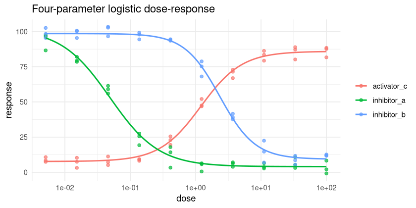

<!-- README.md is generated from README.Rmd. Please edit that file -->

# tidybiotek

<!-- badges: start -->
[](https://github.com/jmozez/tidybiotek/actions/workflows/R-CMD-check.yaml)
[](https://github.com/jmozez/tidybiotek/actions/workflows/lint.yaml)
[](https://github.com/jmozez/tidybiotek/actions/workflows/vercel.yaml)
[](https://github.com/jmozez/tidybiotek)
[](https://lifecycle.r-lib.org/articles/stages.html#experimental)
[](https://github.com/jmozez/tidybiotek/blob/main/LICENSE.md)
[](https://tidybiotek.in4metrix.dev)
[](https://tidyvisor.in4metrix.dev)
[](https://tidymapr.in4metrix.dev)
<!-- badges: end -->

**tidybiotek** brings applied biotechnology bioinformatics into the
tidyverse and tidymodels. Every function takes a data frame first, uses
tidy evaluation for its column arguments and returns a tibble, so whole
analyses read as pipelines. Everything is written in base R and `stats`:
there are no Bioconductor or compiled dependencies, so it installs
cleanly on any system.

| Module | Functions |
|----|----|
| Sequences | `bio_seq_tbl()`, `bio_translate()`, `bio_gc_content()`, `bio_codon_weights()`, `bio_cai()`, `bio_codon_optimise()`, `bio_primer_tm()`, `bio_kmer_count()`, `bio_aa_props()` |
| Assays | `bio_qpcr_ddct()` (delta-delta Ct and Pfaffl), `bio_dose_response()` (4PL IC50 and EC50), `bio_elisa_quant()` |
| Bioprocess | `bio_enzyme_kinetics()` (Michaelis-Menten), `bio_monod_growth()` (batch bioreactor kinetics) |
| Omics | `bio_diff_expr()` (moderated t-test), `bio_enrich()` (over-representation analysis) |
| recipes | `step_bio_kmers()`, `step_bio_aa_props()`, `step_bio_vst_norm()` |
| rsample | `bio_homology_cv()`, `bio_batch_cv()` |
| yardstick | `enrichment_factor()`, `bedroc()`, `assay_cv_error()` |
| parsnip | `bio_four_pl()` with the `"nls_4pl"` engine |
| Reporting | `tidy()`, `glance()`, `augment()` and `autoplot()` methods |

## Installation

Install the development version from GitHub:

``` r
# install.packages("remotes")
remotes::install_github("jmozez/tidybiotek")
```

[tidyvisor](https://github.com/jmozez/tidyvisor) is the companion
statistical advisor for study design, power, assumptions and
interpretation. It is optional: tidybiotek works on its own.

``` r
remotes::install_github("jmozez/tidyvisor")
```

## Sequences

Translate the *E. coli* K-12 coding sequences in `ecoli_cds` and compare
codon adaptation between ribosomal protein genes and other genes:

``` r
library(tidybiotek)
library(dplyr)

ecoli_cds |>
  bio_translate(sequence, code = "bacterial", to_stop = TRUE, start_as_met = TRUE) |>
  bio_gc_content(sequence, by_position = TRUE) |>
  bio_cai(sequence) |>
  group_by(class) |>
  summarise(
    genes = n(),
    translations_match = mean(translated == protein),
    gc3 = mean(gc3),
    cai = mean(cai)
  )
#> # A tibble: 2 × 5
#>   class     genes translations_match   gc3   cai
#>   <chr>     <int>              <dbl> <dbl> <dbl>
#> 1 other        20                  1 0.569 0.439
#> 2 ribosomal    56                  1 0.490 0.695
```

Melting temperatures of common sequencing primers by the
nearest-neighbour method:

``` r
tibble::tibble(
  name = c("M13F", "M13R", "T7"),
  primer = c("GTAAAACGACGGCCAGT", "CAGGAAACAGCTATGAC", "TAATACGACTCACTATAGGG")
) |>
  bio_primer_tm(primer)
#> # A tibble: 3 × 3
#>   name  primer                  tm
#>   <chr> <chr>                <dbl>
#> 1 M13F  GTAAAACGACGGCCAGT     49.2
#> 2 M13R  CAGGAAACAGCTATGAC     43.6
#> 3 T7    TAATACGACTCACTATAGGG  44.6
```

## Assays

Four-parameter logistic fits give IC50 and EC50 values with confidence
intervals:

``` r
fit <- bio_dose_response(dose_response_sim, dose, response, .by = compound)
fit |> select(compound, ec50, ec50_low, ec50_high, hill, type)
#> # A bio_assay: dose_response: 3 x 6
#>   compound      ec50 ec50_low ec50_high  hill type 
#>   <chr>        <dbl>    <dbl>     <dbl> <dbl> <chr>
#> 1 activator_c 1.20     1.06      1.36    1.38 EC50 
#> 2 inhibitor_a 0.0490   0.0413    0.0581 -1.16 IC50 
#> 3 inhibitor_b 2.34     2.07      2.65   -1.61 IC50
```

``` r
autoplot(fit)
```



Relative expression from qPCR Ct values:

``` r
bio_qpcr_ddct(qpcr_sim, ct, gene, sample, treatment,
  reference_genes = c("gapA", "rpoD"), control = "control"
) |>
  tidy() |>
  filter(treatment != "control") |>
  select(gene, treatment, fold_change, conf.low, conf.high, p.value)
#> # A tibble: 8 × 6
#>   gene  treatment fold_change conf.low conf.high    p.value
#>   <chr> <chr>           <dbl>    <dbl>     <dbl>      <dbl>
#> 1 dnaK  heat_42C        7.39     4.86     11.2   0.0000338 
#> 2 dnaK  heat_46C       24.2     16.2      36.1   0.00000193
#> 3 groL  heat_42C        4.22     2.82      6.32  0.000148  
#> 4 groL  heat_46C        7.15     5.73      8.91  0.00000746
#> 5 ibpA  heat_42C       14.1      9.41     21.2   0.0000524 
#> 6 ibpA  heat_46C       59.8     32.5     110.    0.00000489
#> 7 ompF  heat_42C        0.590    0.342     1.02  0.0470    
#> 8 ompF  heat_46C        0.295    0.157     0.556 0.00526
```

## Bioprocess kinetics

``` r
bio_enzyme_kinetics(puromycin_kinetics, substrate, rate, .by = state)
#> # A bio_assay: enzyme_kinetics: 2 x 8
#>   state      vmax vmax_se     km   km_se sigma  nobs method
#>   <chr>     <dbl>   <dbl>  <dbl>   <dbl> <dbl> <int> <chr> 
#> 1 treated    213.    6.95 0.0641 0.00828 10.9     12 nls   
#> 2 untreated  160.    6.48 0.0477 0.00778  9.77    11 nls

bio_monod_growth(fermentation_sim, time_h, biomass_g_l,
  substrate = glucose_g_l, .by = reactor
) |>
  select(reactor, mu_max, ks, yield, doubling_time)
#> # A bio_assay: monod: 3 x 5
#>   reactor mu_max    ks yield doubling_time
#>   <chr>    <dbl> <dbl> <dbl>         <dbl>
#> 1 R1       0.556 0.335 0.512          1.25
#> 2 R2       0.529 0.145 0.473          1.31
#> 3 R3       0.561 0.839 0.466          1.24
```

## Omics

``` r
de <- bio_diff_expr(expression_sim, gene, sample, count, condition,
  treatment = "stress", reference = "control", transform = "log2_cpm"
)
glance(de)
#> # A tibble: 1 × 7
#>   n_features n_significant df_prior s0_sq df_residual treatment reference
#>        <int>         <int>    <dbl> <dbl>       <int> <chr>     <chr>    
#> 1       1000            69     11.8 0.150           6 stress    control

bio_enrich(de, feature, p_adj < 0.05 & log2fc > 0, gene_sets_sim) |>
  select(gene_set, set_size, overlap, fold_enrichment, p_adj) |>
  head(3)
#> # A tibble: 3 × 5
#>   gene_set          set_size overlap fold_enrichment    p_adj
#>   <chr>                <int>   <int>           <dbl>    <dbl>
#> 1 stress_response         40      26           15.1  1.29e-28
#> 2 background_set_18       52       6            2.68 3.05e- 1
#> 3 background_set_21       17       3            4.10 3.31e- 1
```

## tidymodels

Sequence features, homology-aware resampling and early-recognition
metrics plug straight into tidymodels:

``` r
rec <- recipes::recipe(class ~ protein, data = ecoli_cds) |>
  step_bio_aa_props(protein) |>
  recipes::prep()
recipes::bake(rec, new_data = NULL) |> head(3)
#> # A tibble: 3 × 10
#>   class     protein_length protein_mol_weight protein_isoelectric_point
#>   <fct>              <dbl>              <dbl>                     <dbl>
#> 1 ribosomal            234             24730.                      10.3
#> 2 ribosomal            273             29860.                      11.6
#> 3 ribosomal            209             22244.                      10.7
#> # ℹ 6 more variables: protein_charge_ph7 <dbl>, protein_gravy <dbl>,
#> #   protein_aromaticity <dbl>, protein_frac_acidic <dbl>,
#> #   protein_frac_basic <dbl>, protein_frac_hydrophobic <dbl>

set.seed(1)
bio_homology_cv(ecoli_cds, protein, v = 5, k = 2, threshold = 0.2)
#> # 5-fold homology-aware cross-validation (k = 2, threshold = 0.2) 
#> # A tibble: 5 × 2
#>   splits          id   
#>   <list>          <chr>
#> 1 <split [60/16]> Fold1
#> 2 <split [61/15]> Fold2
#> 3 <split [61/15]> Fold3
#> 4 <split [61/15]> Fold4
#> 5 <split [61/15]> Fold5
```

## Data

`ecoli_cds` comes from NCBI RefSeq NC_000913.3, `dnase_elisa` and
`puromycin_kinetics` are tidy copies of the classic R datasets `DNase`
and `Puromycin`. `qpcr_sim`, `dose_response_sim`, `fermentation_sim`,
`expression_sim` and `gene_sets_sim` are simulated with known true
values so that methods can be checked; `data-raw/make_data.R` builds
them all.

## Licence

MIT (c) Jimmy Moses
